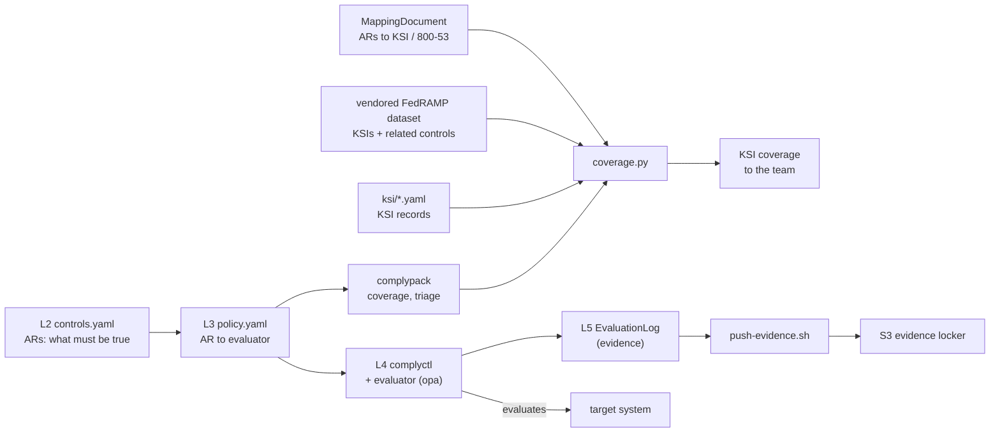

# ROSA Seaplane Compliance

A framework for proving ROSA Seaplane meets its security certifications (the
first being FedRAMP Class C). New controls will be added through iteration.

To run the verification and diagnose a failure, jump to
[Run the verification and understand a failure](#run-the-verification-and-understand-a-failure).

It is built on [Gemara](https://github.com/gemaraproj/gemara)'s layered model: a
control is written once, in a certification-neutral way, and each certification is
a thin mapping layer on top. From that, the framework produces:

1. **The mappings:** for every requirement in a certification (e.g. a NIST 800-53
   control), which control satisfies it and why.
2. **The evidence:** the record of each evaluation, run against the live system
   via complytime, showing the controls actually held.

The pieces map onto Gemara's layers, called out below as L2 through L5. L2 and L3
are authored here, L4 is run with complyctl, and L5 is collected. The
MappingDocument ties the controls to each certification's requirement IDs.

## Terms you'll meet

Roughly in the order you run into them. If a name in the output means nothing to
you, look here first.

**The compliance frame**

- **FedRAMP:** the US federal program that authorizes cloud services for
  government use. **20x** is its newer path: instead of writing documents about
  controls, a provider proves security with automated, machine-checkable evidence.
  **Class C** is the 20x certification tier this project targets. It needs at
  least 2 automated checks per KSI, and a daily history of results.
- **KSI (Key Security Indicator):** a security outcome FedRAMP 20x asks you to
  demonstrate, e.g. `KSI-CMT-VTD` ("Persistent testing and validation of changes
  throughout deployment is automated"). There are 46. The ID is
  `KSI-<family>-<abbreviation>` (`CMT` = Change Management). A KSI is a claim; it
  is proven by evidence from ARs.
- **NIST SP 800-53 and control IDs:** a US government catalog of security
  controls, grouped into families with a two-letter prefix: `cm` Configuration
  Management, `au` Audit and Accountability, `ac` Access Control, `ia`
  Identification and Authentication, `ir` Incident Response, `si` System and
  Information Integrity. `cm-3` is the control "Configuration Change Control"
  (changes are reviewed, approved and tracked). `cm-3.2` is its second
  enhancement, "testing, validation and documentation of changes"; the same ID is
  written `CM-03 (02)` in our mapping files, and `scripts/fedramp_data.py`
  converts between them. On the 20x path 800-53 is reference material, not a
  requirement: each KSI lists **related controls** so you can check you did not
  miss an angle.
- **Control status per KSI:** a related control is **addressed** when one of our
  ARs that serves the KSI maps to it, **inherited** or **not-applicable** when
  the KSI record says so with a rationale, and **open** otherwise. It is a
  property of the pair (KSI, control): `cm-3` can be addressed for one KSI and
  open for another.
- **SDR (Security Decision Record):** the document FedRAMP 20x asks for, in JSON
  and human-readable form: per KSI, what is measured, how often, why the
  measurement is trustworthy, and the evidence. `make sdr` generates it.

**What this repo calls things**

- **Control and control domain:** a **control** states something that must be
  true, in certification-neutral language (e.g. `RSC.CMT.CTRL01`, reviewed and
  validated changes to the default branch). A **control domain** is a subject-area
  grouping, one directory under `gemara/`. `RSC` is the project prefix on every ID.
- **AR (Assessment Requirement):** one testable condition under a control, e.g.
  `RSC.CMT.CTRL01.AR01` (the merge gate is configured and enforced) or `AR02`
  (every merged PR respected it). ARs are the unit of work: each has a check.
- **Mapping (MappingDocument):** a file saying which KSI or 800-53 control an AR
  provides evidence for, and why (the `rationale`). Adding a certification means
  adding a mapping file; controls are never edited.
- **Method:** an AR that is implemented as an automated check for a KSI. Class C
  needs at least 2 per KSI, ideally of different kinds: **intent** (is it
  configured?) and **behavioral** (did it hold in practice?).
- **State vs result:** two separate signals. **State** (Not started, In progress,
  Covered, SDR-ready) is how far the checks are implemented. **Result** (passed,
  failed, not evaluated) is what the latest run found. A KSI can be fully
  implemented and failing, or vice versa. Coverage never depends on pass/fail.
- **Scope and manifest:** scope is the set of targets a check must reach (the 7
  repositories today, AWS accounts later). Each collector writes a
  `manifest.json` saying which targets it reached or failed to reach, so a repo
  that was silently skipped is visible and is never mistaken for a pass.

**The layers (Gemara)**

- **Gemara** is the layered model our files are written in: **L1** guidance (the
  external requirements, e.g. FedRAMP's data), **L2** controls and ARs
  (`gemara/*/controls.yaml`), **L3** policy, which says which evaluator checks each
  AR and how often (`gemara/*/policy.yaml`), **L4** the evaluation, and **L5** the
  **EvaluationLog**, the record of one run with one result per AR.

**The machinery**

- **Collector and evidence:** a collector (`evidence/*.sh`) gathers raw facts
  (GitHub API, later AWS) and normalizes them into **evidence**, a JSON file per
  target in `evidence/output/`.
- **Rego, OPA, conftest, evaluator:** the check itself is a Rego policy
  (`opa/*/policy/*.rego`), run by OPA through conftest. The **evaluator** is the
  complyctl provider that runs it (currently only `opa`).
- **complytime, complyctl, complypack:** complytime is the project; `complyctl`
  is its CLI, which runs a policy against the system and writes the EvaluationLog.
  `complypack` packages the Rego for delivery and reports which ARs have a check.

**Your merge process (it shows up in AR01 and AR02)**

- **Prow, Tide and the labels:** Prow is OpenShift's CI system. **Tide** is its
  merge bot: it merges a PR only when it carries the `lgtm` (a reviewer approved)
  and `approved` (an OWNERS approver approved) labels and CI is green. People set
  them with `/lgtm` and `/approve` comments, which Prow also reads in review
  bodies. This replaces GitHub's own "required reviews", which is why AR01 and AR02
  read Prow data. See "Known gaps" for what Prow does and does not enforce.

## Run the verification and understand a failure

Assumes the one-time setup in ["From scratch"](#from-scratch-one-full-local-run-step-by-step)
(steps 1 to 6) is done. Each time you want to verify:

```bash
export XDG_DATA_HOME="$HOME/.local/share"   # macOS only: where complyctl looks for the provider
export GITHUB_TOKEN=...                     # read-only; see docs/credentials.md
podman start local-oci-registry             # the local registry from step 5

make test && make validate                  # 1. is the repo itself sound? No credentials needed.
make publish-policy publish-complypack      # 2. publish what the scan fetches (redo after editing any control, policy or Rego)
make run-local                              # 3. collect evidence from the in-scope repos, then scan
make coverage                               # 4. how far along is each KSI
make sdr-view                               # 5. build output/sdr/index.html and open it in a browser
```

**Reading the result.** `make run-local` ends with one row per AR and a summary
such as `2 requirements: 0 passed, 2 failed, 0 not applicable, 0 skipped, 0 errors`.
- **Failed** is a finding: the check ran and the system does not meet the
  requirement. It is not a pipeline error.
- **errors > 0** is a problem with the pipeline itself (provider, config), not a
  finding.
- A repository that could not be reached is neither: it shows as missing scope
  (`targets 6/7` in `make coverage KSI=<id>`), never as a pass.

**If an AR failed, find out why.**

```bash
make why AR=RSC.CMT.CTRL01.AR02     # per-repository denials, and any repo the collector could not reach
```

The scan keeps only one message per AR, so `make why` re-reads the evidence files
(`evidence/output/<AR>/<repo>.json`) with the same policies and lists every
denial by repository. Then look at what the AR requires
(`complypack requirements --catalog RSC.CMT.CTRL --config complypack.yaml --format text`),
the check itself (`opa/<domain>/policy/<name>.rego`, named in the AR's page in the viewer), and
the scan's own report (`.complytime/scan/report-*.md`).

**If the run itself breaks, find your symptom.**

| What you see | What it means | What to do |
| :-- | :-- | :-- |
| `make test` or `make validate` fails | The code or a catalog is broken. | Fix it first; the output names the file. |
| `ERROR: GITHUB_TOKEN must be set`, or `Bad credentials (HTTP 401)` | Token missing, expired or revoked. | `gh api user` to check it; mint a new one per `docs/credentials.md`. |
| `WARN: <AR>: could not collect <repo>: …` | One repo failed; the run continues and the repo shows as missing scope. | Read the reason. `Resource not accessible by personal access token` means the token lacks permission on that repo (`docs/credentials.md`). To retry just that collector: `RSC_EVIDENCE_DIR=$PWD/evidence/output ./evidence/<AR>.sh`. |
| `no evidence collected for <AR>; refusing to scan` or `no repository could be collected` | A collector produced nothing, so the scan is refused (missing evidence would look like a pass). | Run that collector alone (above) and fix what it prints. |
| `no providers found` | complyctl cannot find the `opa` provider. | Set `XDG_DATA_HOME` as above and install the provider (setup steps 3 and 4). |
| Policy or complypack fetch errors | Registry down, or nothing published. | `curl localhost:5050/v2/_catalog`, then `make publish-policy publish-complypack`. |
| Scan summary shows `errors` above 0 | Provider or configuration failure. | `.complytime/complyctl.log` and `complyctl doctor --format text`. |
| `make coverage` shows `not run` under Scope | No collector manifests were written. | Run `make run-local` first. |
| An AR fails and you think the policy is wrong | Either the check or the collector is mis-measuring. | Reproduce with a fixture in `tests/fixtures/<AR>/`, fix what it measures in the Rego or collector, run `make test`. Do not loosen a check to make it pass. |

## The mental model



- **Control catalog, Gemara L2** (`gemara/*/controls.yaml`): what must be true,
  framework-neutral, split into testable **assessment requirements (ARs)**.
  Nothing here names FedRAMP or NIST.
- **Policy, Gemara L3** (`gemara/*/policy.yaml`): wires each AR to an
  **evaluator** (`opa`, for both configuration and behavioural checks)
  and to the target system.
- **Evaluation, Gemara L4:** complyctl runs the policy through those evaluators
  against the real repo.
- **EvaluationLog, Gemara L5:** the evidence complyctl emits, recording that each
  AR passed or failed.
- **MappingDocument** (`mappings/*.mapping.yaml`): Gemara's cross-cutting layer
  and the *only* place a certification's vocabulary lives. Each file translates
  the ARs into one framework's requirements. Adding a certification is adding a
  mapping file; the control is never touched.
- **FedRAMP dataset** (`mappings/vendor/fedramp/fedramp-consolidated-rules.json`):
  the authority for the KSIs and their related controls, i.e. what coverage
  measures against.
- **KSI records** (`mappings/fedramp-20x/ksi/*.yaml`): the hand-written SDR
  explanations and control exceptions that cannot be derived.

## What comes out

| Output | Built by | Audience | Shape |
| :-- | :-- | :-- | :-- |
| **Coverage** | `coverage.py` | the team | Per KSI: implemented methods (via `complypack coverage` and `triage`), scope reached, related controls decided, explanations written. Never reads pass/fail. |

Coverage means the checks are implemented. It needs no L5 EvaluationLog, and a failing check does not change it.

## Running an evaluation

See [docs/credentials.md](docs/credentials.md) for how to obtain every
credential referenced below (`GITHUB_TOKEN`, `RSC_S3_BUCKET`/AWS, the OCI
registry). By default nothing here touches anything public or real: the
OCI registry and S3 bucket below are local-only (see `Makefile`'s `REGISTRY`
and `docs/credentials.md`).

Once everything below is installed once, the steady-state loop is just:

```bash
make validate                  # optional: cue vet the Gemara YAML against upstream schema
make publish-policy            # push each domain's L2 controls + L3 policy as an OCI bundle
make publish-complypack        # push all domains' Rego as one complypack (opa evaluator)
export GITHUB_TOKEN=ghp_...
make run-local                 # collect evidence, then complyctl scan (the L4 run)
                               #   (or: make build-image && make run-image)
export RSC_S3_BUCKET=... RSC_S3_ENDPOINT_URL=...
make push-evidence              # push evidence/output/ + .complytime/scan/ to the evidence locker
make env                       # which environment (RSC_ENV, default integration) and AWS profiles are set
make coverage                  # the team's KSI coverage view
make sdr                       # the FedRAMP Security Decision Record (output/sdr/sdr.json)
make trace                     # AR trail data: ARs joined to what they evidence (output/trace.json)
make sdr-view                  # offline HTML viewer: AR trail + KSIs (output/sdr/index.html)
```

### From scratch: one full local run, step by step

Everything below is verified end to end against the 7 repositories in
`config/scope.yaml`, pushing to a local OCI registry and a local S3-compatible
bucket — nothing public or real AWS required.

**1. Prerequisites:** `go` (1.23+), `podman` (or `docker`), `python3`+`pip3`,
`aws` CLI, `gh` CLI, `jq`.

```bash
python3 -m venv .venv && .venv/bin/pip install -r requirements.txt   # the Makefile uses .venv when present
```

**2. Install complyctl and most of the toolchain** (unpinned
`@latest` here; pin before relying on this for real evidence — see
`containers/complyctl/Containerfile` for pinned versions):

```bash
go install github.com/complytime/complyctl/cmd/complyctl@latest
go install github.com/open-policy-agent/conftest@v0.71.1
go install oras.land/oras/cmd/oras@latest
go install github.com/complytime/complypack/cmd/complypack@latest
```

**3. Build the stock `opa-provider`** (v0.3.0 works unpatched; complyctl
delivers the Rego as a complypack, so the provider needs no registry access):

```bash
go install github.com/complytime/complytime-providers/cmd/opa-provider@v0.3.0
```

**4. Install the provider where complyctl looks for it:**

```bash
mkdir -p "$HOME/.local/share/complytime/providers"
cp "$(go env GOPATH)/bin/opa-provider" "$HOME/.local/share/complytime/providers/complyctl-provider-opa"
chmod +x "$HOME/.local/share/complytime/providers/complyctl-provider-opa"
# macOS only: complyctl looks in ~/Library/Application Support/complytime by
# default; this repo's config assumes the Linux XDG path above instead.
export XDG_DATA_HOME="$HOME/.local/share"
```

**5. Start the local OCI registry and S3-compatible bucket:**

```bash
podman run -d --name local-oci-registry -p 5050:5000 docker.io/library/registry:2
podman run -d --name local-s3 -p 9090:9090 docker.io/adobe/s3mock:latest
export AWS_ACCESS_KEY_ID=test AWS_SECRET_ACCESS_KEY=test AWS_DEFAULT_REGION=us-east-1
aws --endpoint-url http://localhost:9090 s3 mb s3://rosa-seaplane-evidence
```

**6. Set a scoped `GITHUB_TOKEN`** (see `docs/credentials.md` for how to mint
a token scoped to just this; don't reuse a broad personal token):

```bash
export GITHUB_TOKEN=github_pat_xxxxxxxx
```

**7. Run the pipeline, one command at a time.** Each one below produces a
real artifact (or none); the command under "explore" lets you look at it
natively, without any extra tooling beyond what's already installed.

**`make validate`** — optional. No artifact: `cue vet` checks
every `gemara/*/{controls,policy}.yaml` and every
`mappings/*.mapping.yaml` file against the upstream Gemara CUE schema,
pass/fail to stdout only.

**`make publish-policy`** — pushes each domain's `gemara/<domain>/{controls,policy}.yaml`
as one OCI artifact, e.g. `localhost:5050/.../policies/change-management:v0.1.0`.
The artifact lives in the registry, not your filesystem:
```bash
oras pull --plain-http localhost:5050/rosa-seaplane-compliance/policies/change-management:v0.1.0 -o /tmp/policy-bundle
cat /tmp/policy-bundle/controls.yaml
```

**`make publish-complypack`** — packs all `opa/*/policy/*.rego` (minus
`_test.rego`) plus the merged `complytime-mapping.json` into one complypack with
`complypack pack` (validating against `complypack.yaml` first) and pushes it to
`.../complypacks/rosa-seaplane:v0.1.0`. `make run-local` fetches it via the
`complypacks:` entry in `.complytime/complytime.yaml`; after a run, the
unpacked copy is in complyctl's cache:
```bash
ls ~/.cache/complytime/complypacks/opa/*/content   # macOS: ~/Library/Caches/complytime/...
```

**`make run-local`** (with `GITHUB_TOKEN` already exported from step 6) —
the big one. Collects real evidence from
`openshift-online/rosa-seaplane`, runs `complyctl scan`, and writes four
artifacts. Expect both `RSC.CMT.CTRL01.AR01` and `AR02` to report `❌
Failed` — those are real findings against the real repo, not broken tooling
(see the command's own output for the exact reasons).

- *Raw evidence*, `evidence/output/<AR-FQDN>/evidence.json` — exactly what
  each `evidence/*.sh` collector wrote from the GitHub API:
  ```bash
  jq . evidence/output/RSC.CMT.CTRL01.AR01/evidence.json
  jq '.pull_requests | length' evidence/output/RSC.CMT.CTRL01.AR02/evidence.json
  ```
- *L5 EvaluationLog*, `.complytime/scan/evaluation-log-*.yaml` — Gemara's
  own result format, one per target:
  ```bash
  cat .complytime/scan/evaluation-log-*-opa-*.yaml   # or yq, it's plain YAML
  ```
- *OSCAL assessment results*, `.complytime/scan/assessment-results-*.json`
  — the same data reshaped into NIST OSCAL. Top level is
  `{"assessment-results": {uuid, metadata, back-matter, results}}`; findings
  are under `results[].findings`/`results[].observations`:
  ```bash
  jq '.["assessment-results"].results[0].findings' .complytime/scan/assessment-results-*-opa-*.json
  ```
- *SARIF*, `.complytime/scan/scan-*.sarif.json` — standard SARIF shape, so
  any SARIF viewer (e.g. VS Code's SARIF extension) opens it directly; by
  hand:
  ```bash
  jq '.runs[0].results[] | {ruleId, level, message: .message.text}' .complytime/scan/scan-*-opa-*.sarif.json
  ```
- *Markdown report*, `.complytime/scan/report-*.md` — just `cat`/open it, a
  formatted human-readable summary of the same scan.

There's also provider-internal state worth poking at:
`.complytime/opa/` (the provider's generated scan
config and raw conftest results).

**`make push-evidence`** — copies everything from the `run-local` step
(`evidence/output/` + `.complytime/scan/`) into
`s3://$RSC_S3_BUCKET/$RSC_S3_PREFIX/<run-timestamp>/{evidence,scan}/`:
```bash
export RSC_S3_BUCKET=rosa-seaplane-evidence RSC_S3_ENDPOINT_URL=http://localhost:9090
make push-evidence
aws --endpoint-url "$RSC_S3_ENDPOINT_URL" s3 ls --recursive "s3://$RSC_S3_BUCKET/"
aws --endpoint-url "$RSC_S3_ENDPOINT_URL" s3 cp "s3://$RSC_S3_BUCKET/.../scan/report-...-opa-....md" -   # stream one object without downloading
```

**`make coverage`** — the KSI rollup: one row per in-phase KSI with its
methods, scope, controls, narrative and state. Also writes
`output/coverage.json` (gitignored). `make coverage KSI=KSI-CMT-VTD` drills
into one KSI and lists what to do next. Needs `complypack` installed.

**`make sdr`** — runs `make coverage`, then transforms its output, the KSI
records, the policies' planned cycle and the latest L5 results into
`output/sdr/sdr.json`, validated against the vendored FedRAMP SDR schema.
Failed results stay visible; an AR with no result is "not evaluated"; the
assessor fields are left empty. Local paths, usernames, account IDs and raw
evaluation messages are never written. The output is gitignored because it
describes real findings. Needs the `.venv` (see `requirements.txt`).

**`make trace`** — builds `output/trace.json`, the data behind the AR pages:
every assessment requirement (AR) joined to the requirements it evidences (KSIs,
800-53 controls, any framework a mapping file names, each link with its
rationale), its policy plan, collector, schema, Rego and fixtures, the targets
the collectors reached (from `manifest.json`), and its latest result. It fails,
listing every problem, if a link does not resolve (see "Walking the trail").
Results are AR-level only, as the scan records them.

**`make sdr-view`** — builds the trace, then renders `output/sdr/index.html`
from `sdr.json`, `coverage.json` and `trace.json`. Open it in a browser. Two
tabs: **Assessment requirements** (the landing page: an index of ARs, and one
page per AR) and **KSIs** (an overview by family, a filterable list, and a page
per KSI), linked both ways. It is fully offline (no external scripts, fonts or
requests), HTML-escapes all data, and shows implementation state and
pass/fail as separate signals. Don't publish it anywhere: it describes real
findings.

### Walking the trail

If you are new to this repo, or to compliance, start at the **AR page**, because
every path from a requirement to evidence passes through exactly one AR. Open
`output/sdr/index.html` and pick an AR. The page is an hourglass:

- **Above the waist, why it exists:** the KSIs, 800-53 controls and any other
  framework's requirements it evidences, each with the reason it counts. A
  framework with no mapping from this AR says so; a new certification appears as
  one more block once it has a mapping file.
- **Below the waist, how it is checked and the proof:** scope (which targets were
  reached), the collector, the evidence shape (schema), the Rego and its
  fixtures, what it checks, when it fails, failure handling, cadence, and the
  latest result. "Fails when" and "Failure handling" read **not defined yet**:
  they have no structured home in the catalog, and the viewer does not invent
  them.
- **Why did it fail? Look here:** the viewer shows pass or fail only. The scan
  records one result and one message per AR, not per target, so the box lists
  where the reason lives: the latest `report-*.md`, the raw L5 log, the evidence
  files, and the `conftest test ...` command that prints the denials for one
  piece of evidence.

The same trail without the viewer, for AR01: its text in
`gemara/<domain>/controls.yaml`; its plan in `policy.yaml`; the links to KSIs and
800-53 in `mappings/*.mapping.yaml`; the Rego in `opa/<domain>/policy/` (the
package is named in `complytime-mapping.json`); the shape it reads in
`schemas/` (named by the Rego's `# schema:` header); the collector
`evidence/<AR>.sh`; the results in `.complytime/scan/`.

**Convention `build_trace.py` enforces:** each Rego file starts with
`# platform: <name>` and `# schema: schemas/<name>.cue` headers (the latter an
explicit pointer to the evidence shape, so it is not a guess). Every AR with an
Automated plan needs its collector, a package in `complytime-mapping.json`, the
Rego file and the schema, or `make trace` fails.

## Where evidence goes

Each run's raw evidence (`evidence/output/`) and L5 EvaluationLog
(`.complytime/scan/`) land locally first. `make push-evidence`
(`scripts/push-evidence.sh`) then pushes both to a shared **evidence locker**
(an S3 bucket) under a timestamped, append-only prefix
(`s3://$RSC_S3_BUCKET/$RSC_S3_PREFIX/<run-timestamp>/`), so history survives
between runs. Aggregating/verifying across runs still comes after that; this
repo's job is running the evaluation, and getting the evidence to
the locker — not analyzing the locker's contents.

Requires `RSC_S3_BUCKET` (and AWS credentials for it) in the environment.
For local development against a non-AWS S3-compatible endpoint (e.g.
[adobe/s3mock](https://hub.docker.com/r/adobe/s3mock), MinIO), also set
`RSC_S3_ENDPOINT_URL`:

```bash
podman run -d --name local-s3 -p 9090:9090 docker.io/adobe/s3mock:latest
export AWS_ACCESS_KEY_ID=test AWS_SECRET_ACCESS_KEY=test AWS_DEFAULT_REGION=us-east-1
aws --endpoint-url http://localhost:9090 s3 mb s3://rosa-seaplane-evidence
RSC_S3_BUCKET=rosa-seaplane-evidence RSC_S3_ENDPOINT_URL=http://localhost:9090 make push-evidence
```

## Where things live

- `gemara/<domain>/` the L2 control catalog and L3 policy for one control domain,
  certification-independent (`change-management` is an example domain).
- `mappings/*.mapping.yaml` one MappingDocument per certification (KSI, NIST 800-53).
- `mappings/fedramp-20x/` `ksi-scope.yaml` (which KSIs this phase builds) and `ksi/*.yaml` (KSI records).
- `config/scope.yaml` the repositories in scope.
- `mappings/vendor/fedramp/` unmodified copies of the FedRAMP Gemara layer
  files (NIST 800-53 guidance catalog, KSI control catalog, Class C policy)
  that the mapping IDs above are checked against, plus the FedRAMP consolidated
  rules dataset and SDR schemas. Only the dataset (`scripts/fedramp_data.py`) is
  read by code; the `layer*` files are legacy reference.
- `opa/<domain>/policy/*.rego` the Rego checks, one package per AR (e.g. `github_default_branch_merge_review.rego` for `RSC.CMT.CTRL01.AR02`). Each only judges evidence whose `assessment_requirement` matches its AR, authored per domain but published together as one complypack.
- `evidence/<AR-FQDN>.*` one executable collector per AR, named by its AR FQDN (e.g. `RSC.CMT.CTRL01.AR01.sh`), pulling that AR's raw evidence (GitHub via `gh api` today). The entrypoint runs every executable here. Each collects from every repo in `config/scope.yaml` into `evidence/output/<AR>/<repo>.json` plus a `manifest.json` of per-repo `collected`/`error` status (shared code in `evidence/lib/collect.sh`). One repo failing never stops the others.
- `scripts/` `coverage.py`, the `publish-*.sh` helpers, and `push-evidence.sh` (evidence -> S3 locker).
- `.complytime/complytime.yaml` complyctl runtime config, **generated** by `make config`
  (`scripts/render_complytime_config.py`) from the `gemara/*/` domains; gitignored.
  Adding a domain needs no config or Makefile edit, only an entry in `complypack.yaml`
  `gemara.sources` (complypack has no glob support; `make test` fails if one is missing).
- `containers/complyctl/` image bundling complyctl + both evaluators, for scheduled runs.

## Known gaps

- No KSI is covered yet: Class C needs at least 2 implemented automated methods
  per KSI reaching every in-scope target (see `make coverage`). `gemara/change-management`
  is still the only control domain.
- `RSC.CMT.CTRL01.AR02` does not detect admin-bypass merges (needs the org audit log API).
- `RSC.CMT.CTRL01.AR01` is mechanism-neutral: the collector normalizes how approval is required (GitHub required reviews, or the Prow Tide merge bot's labels read from `openshift/release`) into `approval_gate`, and the policy judges two separate facts, that a gate exists and that GitHub enforces it. The team's gate is Tide's `lgtm` + `approved` labels, which GitHub does not enforce (no merge restrictions, `tide` is not a required status), so merges that skip it are possible; that is reported, as is administrator bypass.
- `RSC.CMT.CTRL01.AR02` judges approval from a normalized `approved_by`, built by the collector from GitHub approving reviews and Prow `/lgtm` history (the team approves through Prow, so GitHub's review decision is mostly empty). A Prow approval counts only when both the `lgtm` and `approved` labels are present and a non-author, non-bot account has an unretracted `/lgtm` or `/approve` in a comment or review body made before the merge. A bot that labels its own PR therefore has no human approver and is reported, unless the documented **automation exemption** applies (`config/automation.yaml`). It applies only when all five facts hold: the author is allowlisted; the repo's Tide config has a dedicated approval-requiring query for that author; the approval labels are present; the merge bot (not a person, not the bot itself) merged it; and every commit is the author's own with a valid signature. Failing checks and self-merges are still reported. Results state how many merges relied on the exemption, and that its approval is pending until a person other than the proposer fills `approved-by`. Today the Konflux bot merges its own PRs in `rosa-seaplane-api`, `-kube-applier` and `-zoa` without going through Tide, so those stay flagged.
- Containerfile tool versions are partly `@latest`; pin before relying on this for real evidence.
- `opa-provider` is upstream-flagged as testing-only.
- complyctl's top-level `variables:` (global, as opposed to `targets[].variables`)
  are not expanded for `${ENV_VAR}` references — only target-scoped variables
  are; flag if you hit this.
