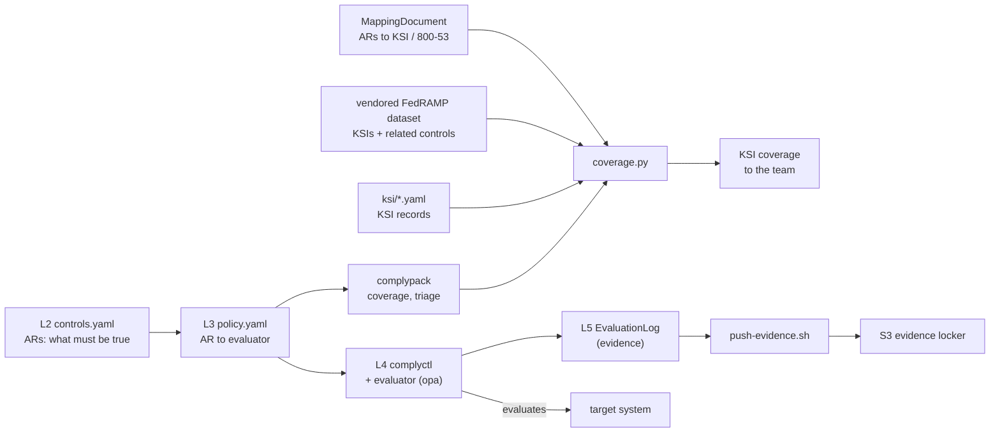

# ROSA Seaplane Compliance

A framework for proving ROSA Seaplane meets its security certifications (the
first being FedRAMP Class C). New controls will be added through iteration.

To run the verification and diagnose a failure, jump to
[Run the verification and understand a failure](#run-the-verification-and-understand-a-failure).

It is built on [Gemara](https://github.com/gemaraproj/gemara)'s layered model: a
control is written once, in a certification-neutral way, and each certification is
a thin mapping layer on top. From that, the framework produces:

1. **The mappings:** for every requirement in a certification (e.g. a NIST 800-53
   control), which control satisfies it and why.
2. **The evidence:** the record of each evaluation, run against the live system
   via complytime, showing the controls actually held.

The pieces map onto Gemara's layers, called out below as L2 through L5. L2 and L3
are authored here, L4 is run with complyctl, and L5 is collected. The
MappingDocument ties the controls to each certification's requirement IDs.

## Terms you'll meet

Roughly in the order you run into them. If a name in the output means nothing to
you, look here first.

**The compliance frame**

- **FedRAMP:** the US federal program that authorizes cloud services for
  government use. **20x** is its newer path: instead of writing documents about
  controls, a provider proves security with automated, machine-checkable evidence.
  **Class C** is the 20x certification tier this project targets. It needs at
  least 2 automated checks per KSI, and a daily history of results.
- **KSI (Key Security Indicator):** a security outcome FedRAMP 20x asks you to
  demonstrate, e.g. `KSI-CMT-VTD` ("Persistent testing and validation of changes
  throughout deployment is automated"). There are 46. The ID is
  `KSI-<family>-<abbreviation>` (`CMT` = Change Management). A KSI is a claim; it
  is proven by evidence from ARs.
- **NIST SP 800-53 and control IDs:** a US government catalog of security
  controls, grouped into families with a two-letter prefix: `cm` Configuration
  Management, `au` Audit and Accountability, `ac` Access Control, `ia`
  Identification and Authentication, `ir` Incident Response, `si` System and
  Information Integrity. `cm-3` is the control "Configuration Change Control"
  (changes are reviewed, approved and tracked). `cm-3.2` is its second
  enhancement, "testing, validation and documentation of changes"; the same ID is
  written `CM-03 (02)` in our mapping files, and `scripts/fedramp_data.py`
  converts between them. On the 20x path 800-53 is reference material, not a
  requirement: each KSI lists **related controls** so you can check you did not
  miss an angle.
- **Control status per KSI:** a related control is **addressed** when one of our
  ARs that serves the KSI maps to it, **inherited** or **not-applicable** when
  the KSI record says so with a rationale, and **open** otherwise. It is a
  property of the pair (KSI, control): `cm-3` can be addressed for one KSI and
  open for another.
- **SDR (Security Decision Record):** the document FedRAMP 20x asks for, in JSON
  and human-readable form: per KSI, what is measured, how often, why the
  measurement is trustworthy, and the evidence. `make sdr` generates it.

**What this repo calls things**

- **Control and control domain:** a **control** states something that must be
  true, in certification-neutral language (e.g. `RSC.CMT.CTRL01`, reviewed and
  validated changes to the default branch). A **control domain** is a subject-area
  grouping, one directory under `gemara/`. `RSC` is the project prefix on every ID.
- **AR (Assessment Requirement):** one testable condition under a control, e.g.
  `RSC.CMT.CTRL01.AR01` (the merge gate is configured and enforced) or `AR02`
  (every merged PR respected it). ARs are the unit of work: each has a check.
- **KSI record:** the small hand-written file per KSI
  (`mappings/fedramp-20x/ksi/<KSI>.yaml`) holding what cannot be derived: the
  explanations for the SDR (what is measured, why the automation is accurate, how
  we know it works) and any decision to treat a related control as inherited or
  not applicable, each with a rationale.
- **Mapping (MappingDocument):** a file saying which KSI or 800-53 control an AR
  provides evidence for, and why (the `rationale`). Adding a certification means
  adding a mapping file; controls are never edited.
- **Method:** an AR that is implemented as an automated check for a KSI. Class C
  needs at least 2 per KSI, ideally of different kinds: **intent** (is it
  configured?) and **behavioral** (did it hold in practice?).
- **State vs result:** two separate signals. **State** (Not started, In progress,
  Covered, SDR-ready) is how far the checks are implemented. **Result** (passed,
  failed, not evaluated) is what the latest run found. A KSI can be fully
  implemented and failing, or vice versa. Coverage never depends on pass/fail.
- **Scope and manifest:** scope is the set of targets a check must reach (the 7
  repositories today, AWS accounts later). Each collector writes a
  `manifest.json` saying which targets it reached or failed to reach, so a repo
  that was silently skipped is visible and is never mistaken for a pass.

**The layers (Gemara)**

- **Gemara** is the layered model our files are written in: **L1** guidance (the
  external requirements, e.g. FedRAMP's data), **L2** controls and ARs
  (`gemara/*/controls.yaml`), **L3** policy, which says which evaluator checks each
  AR and how often (`gemara/*/policy.yaml`), **L4** the evaluation, and **L5** the
  **EvaluationLog**, the record of one run with one result per AR.

**The machinery**

- **Evidence locker:** an S3 bucket where `make push-evidence` keeps each run's
  evidence and scan results under a timestamped, append-only prefix, so history
  survives between runs.
- **Collector and evidence:** a collector (`evidence/*.sh`) gathers raw facts
  (GitHub API, later AWS) and normalizes them into **evidence**, a JSON file per
  target in `evidence/output/`.
- **Rego, OPA, conftest, evaluator:** the check itself is a Rego policy
  (`opa/*/policy/*.rego`), run by OPA through conftest. The **evaluator** is the
  complyctl provider that runs it (currently only `opa`).
- **complytime, complyctl, complypack:** complytime is the project; `complyctl`
  is its CLI, which runs a policy against the system and writes the EvaluationLog.
  `complypack` packages the Rego for delivery and reports which ARs have a check.

**Your merge process (it shows up in AR01 and AR02)**

- **Prow, Tide and the labels:** Prow is OpenShift's CI system. **Tide** is its
  merge bot: it merges a PR only when it carries the `lgtm` (a reviewer approved)
  and `approved` (an OWNERS approver approved) labels and CI is green. People set
  them with `/lgtm` and `/approve` comments, which Prow also reads in review
  bodies. This replaces GitHub's own "required reviews", which is why AR01 and AR02
  read Prow data. See "How AR01 and AR02 judge approval" below.

## Run the verification and understand a failure

Assumes the [one-time setup](#one-time-setup) is done. Each time you want to verify:

```bash
export XDG_DATA_HOME="$HOME/.local/share"   # macOS only: where complyctl looks for the provider
export GITHUB_TOKEN=...                     # read-only; see docs/credentials.md
podman start local-oci-registry             # the local registry from the one-time setup

make test && make validate                  # 1. is the repo itself sound? No credentials needed.
make publish-policy publish-complypack      # 2. publish what the scan fetches (redo after editing any control, policy or Rego)
make run-local                              # 3. collect evidence from the in-scope repos, then scan
make coverage                               # 4. how far along is each KSI
make sdr-view                               # 5. build output/sdr/index.html and open it in a browser
```

**Reading the result.** `make run-local` ends with one row per AR and a summary
such as `2 requirements: 0 passed, 2 failed, 0 not applicable, 0 skipped, 0 errors`.
- **Failed** is a finding: the check ran and the system does not meet the
  requirement. It is not a pipeline error.
- **errors > 0** is a problem with the pipeline itself (provider, config), not a
  finding.
- A repository that could not be reached is neither: it shows as missing scope
  (`targets 6/7` in `make coverage KSI=<id>`), never as a pass.

**If an AR failed, find out why.**

```bash
make why AR=RSC.CMT.CTRL01.AR02     # per-repository denials, and any repo the collector could not reach
```

The scan keeps only one message per AR, so `make why` re-reads the evidence files
(`evidence/output/<AR>/<repo>.json`) with the same policies and lists every
denial by repository. Then look at what the AR requires
(`complypack requirements --catalog RSC.CMT.CTRL --config complypack.yaml --format text`),
the check itself (`opa/<domain>/policy/<name>.rego`, named in the AR's page in the viewer), and
the scan's own report (`.complytime/scan/report-*.md`).

**If the run itself breaks, find your symptom.**

| What you see | What it means | What to do |
| :-- | :-- | :-- |
| `make test` or `make validate` fails | The code or a catalog is broken. | Fix it first; the output names the file. |
| `ERROR: GITHUB_TOKEN must be set`, or `Bad credentials (HTTP 401)` | Token missing, expired or revoked. | `gh api user` to check it; mint a new one per `docs/credentials.md`. |
| `WARN: <AR>: could not collect <repo>: …` | One repo failed; the run continues and the repo shows as missing scope. | Read the reason. `Resource not accessible by personal access token` means the token lacks permission on that repo (`docs/credentials.md`). To retry just that collector: `RSC_EVIDENCE_DIR=$PWD/evidence/output ./evidence/<AR>.sh`. |
| `no evidence collected for <AR>; refusing to scan` or `no repository could be collected` | A collector produced nothing, so the scan is refused (missing evidence would look like a pass). | Run that collector alone (above) and fix what it prints. |
| `no providers found` | complyctl cannot find the `opa` provider. | Set `XDG_DATA_HOME` as above and install the provider (one-time setup, steps 3 and 4). |
| Policy or complypack fetch errors | Registry down, or nothing published. | `curl localhost:5050/v2/_catalog`, then `make publish-policy publish-complypack`. |
| Scan summary shows `errors` above 0 | Provider or configuration failure. | `.complytime/complyctl.log` and `complyctl doctor --format text`. |
| `make coverage` shows `not run` under Scope | No collector manifests were written. | Run `make run-local` first. |
| An AR fails and you think the policy is wrong | Either the check or the collector is mis-measuring. | Reproduce with a fixture in `tests/fixtures/<AR>/`, fix what it measures in the Rego or collector, run `make test`. Do not loosen a check to make it pass. |

## The mental model



A control is written once, neutrally (L2). A policy wires each of its ARs to an
evaluator (L3), complyctl runs it against the target (L4) and records the result
(L5). Certifications are thin mapping layers on top: adding one means adding a
mapping file, never editing a control. Coverage (how far along each KSI is) is
derived from the policy, mappings, dataset and KSI records, and needs no scan.
The terms are defined [above](#terms-youll-meet).

## One-time setup

Local-only by default: the OCI registry and S3 bucket below run in containers, so
nothing public or real AWS is touched. `docs/credentials.md` explains every
credential.

1. **Prerequisites:** `go` (1.23+), `podman` (or `docker`), `python3`, `aws` CLI,
   `gh` CLI, `jq`, and a Python venv (the Makefile uses `.venv` when present):
   ```bash
   python3 -m venv .venv && .venv/bin/pip install -r requirements.txt
   ```
2. **Install the tools** (unpinned here; see `containers/complyctl/Containerfile`
   for the versions the image uses):
   ```bash
   go install github.com/complytime/complyctl/cmd/complyctl@latest
   go install github.com/open-policy-agent/conftest@v0.71.1
   go install oras.land/oras/cmd/oras@latest
   go install github.com/complytime/complypack/cmd/complypack@latest
   ```
3. **Build the stock `opa-provider`.** v0.3.0 works unpatched; complyctl delivers
   the Rego as a complypack, so the provider needs no registry access:
   ```bash
   go install github.com/complytime/complytime-providers/cmd/opa-provider@v0.3.0
   ```
4. **Install the provider where complyctl looks for it:**
   ```bash
   mkdir -p "$HOME/.local/share/complytime/providers"
   cp "$(go env GOPATH)/bin/opa-provider" "$HOME/.local/share/complytime/providers/complyctl-provider-opa"
   chmod +x "$HOME/.local/share/complytime/providers/complyctl-provider-opa"
   # macOS only: complyctl looks in ~/Library/Application Support/complytime by
   # default; this repo's config assumes the Linux XDG path above instead.
   export XDG_DATA_HOME="$HOME/.local/share"
   ```
5. **Start the local registry and S3-compatible bucket:**
   ```bash
   podman run -d --name local-oci-registry -p 5050:5000 docker.io/library/registry:2
   podman run -d --name local-s3 -p 9090:9090 docker.io/adobe/s3mock:latest
   export AWS_ACCESS_KEY_ID=test AWS_SECRET_ACCESS_KEY=test AWS_DEFAULT_REGION=us-east-1
   aws --endpoint-url http://localhost:9090 s3 mb s3://rosa-seaplane-evidence
   ```
6. **Set a scoped `GITHUB_TOKEN`** (`docs/credentials.md` says how; do not reuse a
   broad personal token): `export GITHUB_TOKEN=github_pat_xxxxxxxx`

## Commands

| Command | What it does | How to look at the result |
| :-- | :-- | :-- |
| `make test` | Rego unit tests, pass/fail fixtures, complypack contract checks, Python tests. No credentials. | pass/fail |
| `make validate` | `cue vet` of every `gemara/*/` file and every mapping against the upstream Gemara schema. | pass/fail |
| `make publish-policy` | Pushes each domain's controls and policy to the registry as one OCI artifact each. | `oras pull --plain-http localhost:5050/rosa-seaplane-compliance/policies/change-management:v0.1.0 -o /tmp/policy-bundle` |
| `make publish-complypack` | Packs every domain's Rego (minus tests) and the merged `complytime-mapping.json` into one complypack, validating first, and pushes it. | after a run: `ls ~/.cache/complytime/complypacks/opa/*/content` (macOS: `~/Library/Caches/complytime/...`) |
| `make run-local` | Collects evidence from every repo in `config/scope.yaml`, then `complyctl scan`. Renders `.complytime/complytime.yaml` first (`make config`). | `evidence/output/<AR>/<repo>.json` and `manifest.json`; in `.complytime/scan/`: `report-*.md` (readable), `evaluation-log-*.yaml` (L5), `assessment-results-*.json` (OSCAL), `scan-*.sarif.json` |
| `make why AR=<id>` | Lists the per-repo denials for an AR and any repo the collector could not reach. | stdout |
| `make push-evidence` | Copies `evidence/output/` and `.complytime/scan/` to the evidence locker under `s3://$RSC_S3_BUCKET/$RSC_S3_PREFIX/<run-timestamp>/`. Needs `RSC_S3_BUCKET` (and `RSC_S3_ENDPOINT_URL` for a local bucket). | `aws --endpoint-url "$RSC_S3_ENDPOINT_URL" s3 ls --recursive "s3://$RSC_S3_BUCKET/"` |
| `make env` | Shows the selected environment (`RSC_ENV`, default `integration`) and which AWS profile variables are set. | stdout |
| `make coverage [KSI=<id>]` | The KSI rollup: per KSI its methods, scope, controls, explanations and state; with `KSI=` a drill-down and next steps. Needs `complypack`. | stdout, and `output/coverage.json` |
| `make sdr` | Builds the FedRAMP Security Decision Record from coverage, the KSI records, the policies' planned cycle and the latest L5 results; validated against the vendored schema. Failed results stay visible, an AR with no result is "not evaluated", assessor fields stay empty, and local paths, usernames, account IDs and raw messages are never written. | `output/sdr/sdr.json` |
| `make trace` | Builds `output/trace.json`: every AR joined to what it evidences (KSIs, 800-53, any framework with a mapping file, each link with its rationale), its plan, collector, schema, Rego, fixtures, the targets reached, and its latest result. Fails, listing every problem, if a link does not resolve. | `output/trace.json` |
| `make sdr-view` | Builds the trace, then renders one offline HTML page with two tabs: **Assessment requirements** (index plus a page per AR) and **KSIs** (overview, filterable list, page per KSI). | open `output/sdr/index.html` |
| `make build-image` / `make run-image` | The same evidence-and-scan loop in a container, for scheduled runs. | |

Everything under `output/`, `evidence/output/` and `.complytime/` is gitignored: it
describes real findings, so do not publish it. The viewer has no external scripts,
fonts or requests and HTML-escapes all data.

## Walking the trail

If you are new to this repo, or to compliance, start at an **AR page**: every path
from a requirement to evidence passes through exactly one AR. Run `make sdr-view`,
open `output/sdr/index.html`, and pick an AR. The page is an hourglass:

- **Above the waist, why it exists:** the KSIs, 800-53 controls and any other
  framework's requirements it evidences, each with the reason it counts.
- **Below the waist, how it is checked and the proof:** scope, collector, evidence
  shape, Rego and fixtures, what it checks, cadence, and the latest result. "Fails
  when" and "Failure handling" read **not defined yet**: the catalog has no
  structured home for them, and the viewer does not invent them.
- **Why did it fail? Look here:** the viewer shows pass or fail only. The box lists
  where the reason lives (see also `make why`).

The same trail without the viewer, for AR01: its text in
`gemara/<domain>/controls.yaml`; its plan in `policy.yaml`; the links to KSIs and
800-53 in `mappings/*.mapping.yaml`; the Rego in `opa/<domain>/policy/` (the package
is named in `complytime-mapping.json`); the shape it reads in `schemas/` (named by
the Rego's `# schema:` header); the collector `evidence/<AR>.sh`; the results in
`.complytime/scan/`.

**Convention `make trace` enforces:** each Rego file starts with
`# platform: <name>` and `# schema: schemas/<name>.cue` headers. Every AR with an
Automated plan needs its collector, a package in `complytime-mapping.json`, the Rego
file and the schema.

## Where things live

- `gemara/<domain>/` the L2 catalog and L3 policy for one control domain,
  certification-independent. Adding a domain needs no config or Makefile edit, only
  entries in `complypack.yaml` `gemara.sources` (complypack has no glob support;
  `make test` fails if one is missing).
- `mappings/*.mapping.yaml` one MappingDocument per certification (KSI, NIST 800-53).
- `mappings/fedramp-20x/` `ksi-scope.yaml` (which KSIs this phase builds) and `ksi/*.yaml` (KSI records).
- `mappings/vendor/fedramp/` the FedRAMP consolidated rules dataset (the authority,
  read by `scripts/fedramp_data.py`), the SDR schemas, and legacy `layer*` reference
  files that no code reads.
- `config/` `scope.yaml` (repositories in scope), `environments/` (regions and
  logical account names, no IDs), `automation.yaml` (the automation exemption).
- `opa/<domain>/policy/*.rego` the checks, one package per AR; each judges only
  evidence whose `assessment_requirement` is its own. Published together as one complypack.
- `evidence/<AR>.sh` one collector per AR (GitHub via `gh api` today), writing
  `evidence/output/<AR>/<repo>.json` plus a `manifest.json` of per-repo
  `collected`/`error`. One repo failing never stops the others. Shared code in
  `evidence/lib/`.
- `schemas/` the evidence shapes. `tests/` unit tests and pass/fail fixtures.
- `scripts/` coverage, SDR, trace and viewer generators, the publish and push helpers.
- `.complytime/complytime.yaml` complyctl config, **generated** by `make config` from the domains; gitignored.
- `containers/complyctl/` the image for scheduled runs.

## How AR01 and AR02 judge approval

- **AR01** is mechanism-neutral. The collector normalizes how approval is required
  (GitHub required reviews, or the Prow Tide merge bot's labels, read from
  `openshift/release`) into `approval_gate`. The policy judges two separate facts:
  that a gate exists, and that GitHub enforces it (merge restrictions or a required
  `tide` status). A gate GitHub does not enforce can be skipped by a merge that
  ignores it. Administrator bypass is reported separately.
- **AR02** judges a normalized `approved_by`, built from GitHub approving reviews and
  Prow `/lgtm` history. A Prow approval counts only when both the `lgtm` and
  `approved` labels are present and a non-author, non-bot account has an
  unretracted `/lgtm` or `/approve` in a comment or review body made before the
  merge. A bot that labels its own PR has no human approver and is reported, unless
  the documented **automation exemption** (`config/automation.yaml`) applies. That
  needs all five facts: the author is allowlisted; the repo's Tide config has a
  dedicated approval-requiring query for it; the approval labels are present; the
  merge bot merged it; and every commit is the author's own with a valid signature.
  Failing checks and self-merges are still reported. Results state how many merges
  relied on the exemption, and that its approval is pending until a person other
  than the proposer fills `approved-by`.

## Known gaps

- `gemara/change-management` is the only control domain.
- AR02 does not detect admin-bypass merges (needs the org audit log API).
- The scan records one result and one message per AR, not per target; `make why`
  recovers the per-target reasons from the evidence files.
- Containerfile tool versions are partly `@latest`; pin before relying on this for real evidence.
- `opa-provider` is upstream-flagged as testing-only, and its upstream `main` does
  not build on macOS (the new retained-evidence package is Linux-only), so we use
  the v0.3.0 release.
- complyctl's top-level `variables:` are not expanded for `${ENV_VAR}` references
  (only target-scoped ones are); flag if you hit this.
